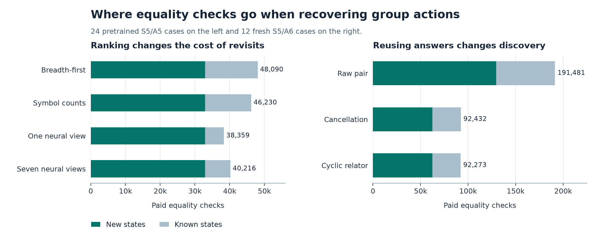

# Exact group recovery with an equality-only oracle

The learner begins at the empty word. It knows that the two generator actions
are permutations, and it knows how many states are reachable. To test a
candidate merge it can ask whether two positive words reach the same state.
The oracle returns one Boolean value and never gives a state name or action.
The result is a rooted transition table up to the naming of its states.

A breadth-first learner expands the shortest representative of each discovered
state. Within each generator column it rules out destinations already used.
After finding the advertised number of states, a column with a single
remaining destination fixes the transition. Other links require an exact
comparison or exhaust the remaining candidates to establish a new state.
The recovered table evaluates any longer word by induction.

## Frozen transformer pilot

The earlier teacher-removal study supplied 24 existing short-label-only
checkpoints, one for each S5 or A5 presentation. Each model had already trained
on 508 exact endpoint labels. The intervention used its class probabilities
only to rank candidate comparisons. A single-view score compares the square
roots of two predicted probability vectors by dot product. Seven views average
the same score over the raw words and six common prefix and suffix contexts.
In every arm the exact comparison determines the merge, and bijectivity
determines the candidate set.
The registered protocol is Bead `1bkj` at `f4d3e5f`.

| Method | S5 checks | A5 checks | Total checks |
|---|---:|---:|---:|
| Breadth-first candidate order | 38,408 | 9,682 | 48,090 |
| Symbol counts | 35,851 | 10,379 | 46,230 |
| One neural view | 30,792 | 7,567 | 38,359 |
| Seven neural views | 32,648 | 7,568 | 40,216 |
| Exact original training labels available | 4,638 | 498 | 5,136 |

A single neural view saved 17.0% relative to the best non-neural black-box arm
by pooled count. Seven views increased queries by 4.8% relative to one.
The pilot scored 14,426 distinct model prompts, including 4,296 raw prompts
needed by the one-view arm. Both neural arms used the same checkpoints.
Training costs are already incurred in this pilot. The retained-label arm
also used 41,094 exact comparisons answered locally from its training cache.
Its comparison cost assumes access to the 508 original labels per group.

All five arms recovered the same exact tables. An independent verifier
replayed 21,600 edges and 11,520 long-word checks across arms and rejected a
deliberately corrupted oracle answer. These totals count shared cases once per
arm. [Frozen baseline study](../../../campaigns/group-student/README.md) · [Active learning in group-structured state spaces](https://www2.cs.uregina.ca/~zilles/bartokSZ10.pdf)

### Why ordering reached a ceiling

Each black-box arm spent 32,962 checks establishing that its next state was
new. A candidate order can help only on the remaining transitions. With
2,136 non-forced revisits, even a ranking that put the correct answer first
every time would need 35,098 checks. Relative to one view, its maximum
possible saving is 8.5% under this learner. The preregistered 10% improvement
target was therefore unreachable by reordering alone on this panel. We
retained the failed gate and tested a mechanism that can reuse past answers.

The pilot output, independent verifier, and checkpoint references are in
`verification.zip`. The training and test words are available in the prior
study's cohort archive. The model weights are retained on the GPU worker
and identified by SHA-256 in the transcript.

## Fresh panel with exact reuse

Two questions can have the same answer by algebra alone. Cancelling a common
prefix or suffix preserves equality and inequality. A more general key takes
the word `uv⁻¹`, freely and cyclically reduces it, and chooses a
canonical cyclic rotation across both orientations. All key transformations
preserve whether the word represents the identity. Consequently, both true
and false Boolean answers can be reused. The oracle is still queried with the
original positive words. [Free-group conjugacy and cyclic reduction](https://ntouikan.ext.unb.ca/MATH6022/IntroCGGT/html_output/sec_free_group_dehn.html)

For any common prefix `p` and suffix `q`, the difference word
`(puq)(pvq)⁻¹` reduces to `p(uv⁻¹)p⁻¹`. That identity explains why
a comparison survives adding or removing both surrounding contexts.

Bead `g52s` froze a new panel of six S5, six A6 and six Z60 presentations.
Each arm used the same search, candidate ordering and exact comparison rule.
Only the cache key varied. The primary pool combined S5 and A6.

| Group | Raw unordered pairs | Prefix and suffix cancellation | Cyclic relator |
|---|---:|---:|---:|
| S5 | 16,839 | 7,691 | 7,623 |
| A6 | 174,642 | 84,741 | 84,650 |
| **Primary pool** | **191,481** | **92,432** | **92,273** |
| Z60 control | 2,463 | 894 | 889 |

The cyclic method saved 51.8% of paid queries and 51.9% of discovery queries.
The latter dropped from 129,687 to 62,427. The preregistered hurdles were
20% overall and 15% on discovery. Simple cancellation captured 99.84% of the
total saving, and the cyclic key avoided another 159 calls. On the macOS
in-process oracle, the primary runs took 0.37 seconds for raw keys, 0.38 for
cancellation, and 1.55 for cyclic keys. These elapsed times include the
simulated Boolean oracle. They measure the local cost of the cache rather
than the delay of an external verifier.



The independent verifier audited all 19,440 transitions and 10,368 sampled
word evaluations across the three arms, including lengths up to 128. It
re-derived cache keys independently, checked every reused answer and rejected
a deliberately corrupted cache answer. macOS and Linux generated identical
transcripts after removing run timings. The common SHA-256 was
`0e80d0165dd29fa9434d98a558fc859a610670fb82881566419e6753dc4a236a`.
The neural pilot also reproduced across the two platforms after removing
timings. Linux DSR passed lint, formatting, type checking, and the full
regression suite with 925 passed and 16 skipped at `09a3481`.

## Sampling correction and scope

The first memoization protocol specified A5 alongside S5 and Z60. I stopped
the run after six S5 measurements when exhaustive enumeration established
that prior work had used all 19 rooted ordered A5 generator classes.
The successor excluded the six partially observed S5 classes and the earlier
cohorts, selected A6, and completed sampling before any queries. The failed
sampling logs are archived.

The experiments compare query policies for a known-cardinality group with a
truthful Boolean equality oracle. They are exploratory benchmark results in
the sizing directory. They measured paid Boolean calls, whereas the earlier
commuting-square experiment measured full endpoint labels.

## Replay

The neural pilot used revision `eb1a04a`. The complete memo study used
`09a3481` with the prior frozen group-student cohort available as the exclusion
list. Run the following checks through DSR from a clean checkout.

```sh
uv run --locked python -m scripts.group_student_probe equality --data /path/to/cohort --runs /path/to/frozen-runs --output /path/to/pilot.json
uv run --locked python -m scripts.group_student_probe relator --data /path/to/cohort --output /path/to/relators.json
```

The verification archive includes independent scripts for auditing the saved
transcripts. The first two commands expect the corresponding JSON from the
archive, with the frozen `group-student` cohort extracted to an empty directory.

```sh
uv run --locked python /path/to/audit-equality.py /path/to/pilot.json /path/to/cohort
uv run --locked python /path/to/audit-relators.py /path/to/relators.json /path/to/cohort
```

[Neural pilot totals](pilot-summary.json) · [Fresh panel totals](relator-summary.json) · [Full transcripts, audit scripts and machine receipts](verification.zip)
