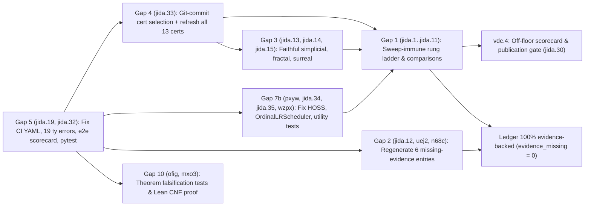

# Bridge Plan: model_guided_research

**Reality check date:** 2026-09-01 (Phase 1, commit `fc6afa8`); bridge plan written 2026-09-02 against commit `e0792c6`; **comprehensive end-to-end reality check + 3 ambition rounds + 5 bead-refinement rounds executed 2026-10-13 against commit `723ee40`**.
**Gap count (2026-10-13 audit):** 7 critical (including 3 newly uncovered regressions in CI/Nightly/Typecheck+Pytest and 2 root-caused mathematical bugs in HOSS and OrdinalLRScheduler), 5 major, 5 minor.
**Beads:** 311+ total. Epic `model_guided_research-jida` (EPIC BRIDGE) parents the self-contained bridge beads, cross-linked with `blocks`/`related` edges to existing domain beads (`vdc.4`, `r7qn`, `pxyw`, `wzpx`, `uej2`, `n68c`, `8gk.5`, `43dd`, `ofig`). The beads carry full background, mathematical derivations, exact commands, preregistrations, companion unit/e2e tests, acceptance criteria, and no-claim lines.
**Estimated work:** Code and quality-gate regressions (`CI` YAML syntax error, 19 `ty check` errors, `e2e_pipeline.py --scenario all` artifact collision, `test_eval_tasks.py` v5 schema mismatch, `test_report.py` mtime time-bomb, `mgr status` certificate selection bug, and the mathematical fixes to `HOSS` and `OrdinalLRScheduler`) are **code-bound (hours, not days)**. The off-floor mechanism-vs-standard battery campaigns (`vdc.4`, `jida.1`..`jida.11`) are **compute-bound** (minutes per 1e12–4e12 cell on this 64-vCPU EPYC box when unloaded; hours at d128/L4 1e14).

This document is the measuring stick for the ambition and refinement rounds. Revise it in place; do not fork it.

---

## Vision checklist (what the README and AGENTS.md promise — audited 2026-10-13 at `723ee40`)

| # | Goal | Source | Status (2026-09-02) | Status (2026-10-13) | Evidence (2026-10-13 Ground Truth) |
|---|------|--------|---------------------|---------------------|------------------------------------|
| V1 | 13 JAX demos, each faithful to its mathematics, runnable via `mgr run` with property checks | README "13 Mathematical Frameworks" | WORKING | **WORKING** | All 13 demos run cleanly on CPU (`JAX_PLATFORMS=cpu`) and pass `tests/test_demos.py` + `tests/test_mathematical_properties.py`. |
| V2 | 13 selectable nanochat attention types, faithful to the frameworks | README "Nanochat", "13 selectable attention types" | PARTIAL | **PARTIAL** | 10 mechanisms are faithful (`standard`, `tropical`, `ultrametric`, `braid`, `gauge`, `reversible`, `hyperbolic`, `quaternion`, `octonion`, `clifford`). **3 remain proxies in code**: `fractal` (flattened branch-softmax router without contractive IFS fixed-point attractor or Moran dimension), `simplicial` (pairwise 2-hop $A(AV)$ without 2-simplex coboundary/boundary operators), and `surreal` (standard SDPA with value weight scaling `exp(s)*normalize(v)` and no Hahn/Levi-Civita valuation score dominance). |
| V3 | Every mechanism passes the new-mechanism checklist (reduction certify, placebo, coordinate check, numerics, interpretability observable, goldens) | `docs/new_mechanism_checklist.md` | PARTIAL | **REGRESSED / PARTIAL** | Coordinate check (`mgr coord-check`) now covers all 11 mechanisms (`jida.18` closed), and gauge reduction landed (`jida.17` closed). **However, `mgr status --json` at HEAD (`723ee40`) reports 8 of 13 mechanisms (`braid`, `gauge`, `octonion`, `reversible`, `standard`, `surreal`, `tropical`, `ultrametric`) as `stale: true`!** Root cause 1: `cli.py:12922` still selects the "newest" certificate per mechanism via `Path(art["path"]).stat().st_mtime`, so after a git checkout/reset (`2026-09-22`), alphabetical path order (`fdxb-cert-refresh` > `cert-refresh-2026-09-02b`) caused the June 2026 certificate (`043db2c`) to overwrite the September 2026 certificate (`dbd2d50`)! Root cause 2: `nanochat/gpt.py` (`885d8d2`) and `nanochat/ultrametric_attention_torch.py` (`63eac57`) were modified after `dbd2d50` without recapturing certificates. |
| V4 | Fixed-FLOPs fair comparison harness producing predicted-vs-observed verdicts across the battery x mechanisms | README "Experimental Matrix", bead `vdc.4` | UNPROVEN | **PARTIAL (in progress)** | Task-tokenizer rung ladder cleared `arith` (0.81/0.86/0.85 vs 0.51 floor at 1e12), `dyck` (0.85/0.86/0.86 vs 0.56 at 1e12), and `regime` v2 (0.08/0.24/0.17 vs 0.042 at 2e12 seq 256). Positive control (`hyp-control-no-context-planted-effect`) is SUPPORTED ($+0.347$, $q=0.0097$). Negative control (`hyp-placebo-no-winner`) is INCONCLUSIVE (9/10 mechanisms within 1.2% of standard; proxy `fractal` straddles at 1.0215, keeping the publication gate blocked). Detached suites (`jida.1`, `jida.10`, `jida.11`) died before committing. |
| V5 | Hypothesis ledger with adjudicated, evidence-backed verdicts | README "Expected Performance Characteristics", `docs/research_loop.md` | PARTIAL | **PARTIAL** | 65 hypotheses (`uv run mgr hypotheses validate` passes): 12 supported, 4 refuted, 11 inconclusive, 7 blocked, 31 open. `engine_today`: 19 `would_rule`, **46 `blocked`** (`metric_missing: 18`, `no_candidate_artifacts: 17`, `prediction_not_operationalized: 7`, `manual_hold: 4`). **6 ledger verdicts still cite 24 missing artifact files** (`evidence_missing` length = 6). |
| V6 | The research loop runs end to end on CPU tiny budgets (`gen-tasks`, `train`, `certify`, `eval-tasks`, `sample`, `adjudicate`) | AGENTS.md "Research Loop", `scripts/e2e_pipeline.py` | WORKING | **REGRESSED** | Marked `[x]` in the 2026-09-02 plan after running scenarios individually, **but `scripts/e2e_pipeline.py --scenario all` FAILS deterministically at `scorecard-contract`** (`scripts/e2e_pipeline.py:970-978`, confirmed in Nightly run `38419052921`) because `scenario_scorecard` shares `work / "artifacts"` with earlier scenarios (`full-loop`, `resume`, `determinism`, `regression-gate`), making `summary["adjudications"]["artifact_count"] == 0` false! |
| V7 | CI green on push; nightly e2e green; static typecheck and fast pytest green | `.github/workflows`, `scripts/ci_lite.sh` | UNPROVEN | **BROKEN / REGRESSED** | **4 independent regressions at HEAD (`723ee40`)**: (1) `.github/workflows/ci.yml:129-131` has a **YAML syntax error** (unquoted `:` in `artifacts: Lean` introduced in `3366370`), causing GitHub Actions to reject `ci.yml` at parse time with 0 jobs (misdiagnosed in `jida.19` as an "account-level GitHub condition"!); (2) `uv run ty check` (`scripts/ci_lite.sh --typecheck`) **FAILS with 19 errors** in `tests/test_algebraic_properties.py`, `tests/test_checkpoint_resume.py`, and `tests/test_mathematical_properties.py`; (3) Nightly E2E (`e2e-nightly.yml`) fails Job 1 (`scorecard-contract`) and Job 2 (`tests/test_eval_tasks.py:380` expects `perturb_eps: 0.0` instead of `[]` after `d3a3e4a`); (4) Local `pytest -m "not slow"` fails `tests/test_report.py:257` due to a 10-day `time.time() - 10 * 86400` time-bomb. |
| V8 | Three optimizers (`adamw`, `muon`, `hoss`) and the `ordinal` scheduler are real, distinct, and mathematically sound | README "Recommended Experimental Protocol" | WORKING | **BROKEN (`WRONG_APPROACH`)** | Config plumbing is distinct, **but both `hoss` and `ordinal` are mathematically broken in training**: (1) `HOSS` (`nanochat/hoss_opt_torch.py:225`, bead `pxyw`) adds a hardcoded `1e-6 * I` jitter to $C_\delta(T) \approx 6\times 10^{-8} I$, injecting noise $5.3\times$ larger than the clipped gradient step, passes unclamped `T` to `_lyapunov_integral_from_eigh`, and drops the orthogonal complement $(I - V_r V_r^\top)g$; (2) `OrdinalLRScheduler` (`nanochat/ordinal_scheduler.py:130-169`, bead `jida.10`) never resets `self.C` on new loss records, so `P_init=100` counts cumulative lifetime non-record steps (~130 steps) instead of a plateau, burning all 3 LR anneals and 2 `optimizer.state.clear()` wipes while loss is still dropping! |
| V9 | GPU / FlexAttention path validated | bead `0jk`, `docs/gpu_flex_diff.md` | UNPROVEN | **UNPROVEN** | No GPU on this host (64-vCPU AMD EPYC 7282, CPU-only). Mechanism edits since June have not been validated on CUDA. |
| V10 | Machine-checked mathematics: theorem registry + Lean proofs of load-bearing lemmas | epic `vnl`, `hypotheses/theorems.yaml` | PARTIAL | **PARTIAL** | `uv run mgr theorems validate` passes: 40 theorems (3 `lean-checked`, 34 `proved-on-paper`, 3 `conjecture`). All Lean `.lean` sources are `sorry`-free; 9 `proved-on-paper` entries still lack a falsifiable numeric check (`ofig`), and CNF rank termination (`mxo3`) is in progress. |
| V11 | Interpretability observable per mechanism in the metrics stream | `docs/new_mechanism_checklist.md` item 6 | PARTIAL | **WORKING (code) / PARTIAL (campaigns)** | Ultrametric route LCP depth & tie fraction (`63eac57`), depth telemetry (`7553163`), and transseries damage ratios (`885d8d2`) landed (`jida.23`, `jida.28` closed). Campaign-level adjudication of their leading-indicator hypotheses remains pending compute. |
| V12 | Documentation states only what the ledger supports | README "Empirical Observations" | WORKING | **WORKING** | README and harness docs (`jida.31`) accurately reflect ledger verdicts, proxy disclaimers, and the sequence-length window rule. |
| V13 | Fixed-FLOPs comparisons measure the mechanism, not the tokenizer | `docs/fixed_flops_harness.md` | WORKING (unproven) | **WORKING** | `--tokenizer task`, `--data-shuffle epoch`, BOS-consistent eval (`mgr.evaltasks.v5`), and the sequence-length window rule are operational and verified by the positive control (`hyp-control-no-context-planted-effect`, SUPPORTED). |
| V14 | Hybrid architectures, mixture of mechanisms, scaling-law study, length extrapolation, optimizer bake-off | README "Future Directions (Immediate)" | NOT_STARTED | **PARTIAL** | Scaling-fit schema (`mgr.bench.scaling_fit.v1`, `jida.26`) and damage-ratio diagnostic (`885d8d2`) landed; compute campaigns (`7b0.3`, `7b0.4`, `w94`, `vdc.5`, `rz8.4`) remain gated on off-floor rungs and working `HOSS`/`Ordinal`. |
| V15 | Reach: standalone attention API, docs site | epic `swh` | NOT_STARTED | **NOT_STARTED** | Backlog (P3). |
| V16 | Reproducibility: bitwise resume, frozen-worktree campaigns, taint propagation | beads `rz8.1`, `nm9j`, `dz9i` | WORKING | **WORKING** | Bitwise checkpoint resume and determinism pass (`tests/test_checkpoint_resume.py`). |

**2026-10-13 Headline Assessment:**
The 2026-09-02/03 sprint built impressive scientific apparatus (epoch shuffling, BOS-consistent evaluator, positive/negative controls, coordinate checks across all 11 mechanisms, depth & route telemetry, theorem-registry axiom auditing), **but left the repository in a broken state at `HEAD` (`723ee40`)**:
1. **Quality gates are red across the board**: `.github/workflows/ci.yml` has a YAML parse error at line 130 (misdiagnosed as a GitHub outage in `jida.19`), `uv run ty check` fails with 19 errors, `e2e-nightly.yml` fails both jobs (`scorecard-contract` shared-artifact bug + `test_eval_tasks.py:380` schema v5 mismatch), `pytest -m "not slow"` fails `test_report.py:257` (mtime time-bomb), and `mgr status` marks 8/13 mechanisms `stale: true` because certificate selection at `cli.py:12922` still uses `st_mtime`.
2. **Two flagship optimization mechanisms (`HOSS` and `OrdinalLRScheduler`) are mathematically broken in `nanochat`**, and **`tests/test_practical_utility.py` has zero assertions across all 11 `test_*` methods**.
3. **Three in-progress compute campaigns (`jida.1`, `jida.10`, `jida.11`) died when their session ended** and left zero committed artifacts.

---

## Critical gaps (block the core value proposition)

### Gap 5 (NOW P0 BLOCKER): CI, Nightly E2E, Typecheck, and Fast Pytest are Broken at `HEAD` — `BROKEN / REGRESSED` to `WORKING`

**Current state (2026-10-13):**
1. **`.github/workflows/ci.yml` YAML syntax error (misdiagnosed in `jida.19`)**: Commit `3366370` wrote an unquoted multi-line step name at lines 129–131 containing `: ` (`artifacts: Lean`). `yaml.safe_load` raises `ScannerError: mapping values are not allowed here in ".github/workflows/ci.yml", line 130, column 31`. GitHub Actions rejects invalid workflow YAML at parse time with 0 jobs and conclusion `failure`. There is no "GitHub account-level scheduling condition"—the YAML file is syntactically invalid!
2. **`uv run ty check` (`scripts/ci_lite.sh --typecheck`) fails with 19 diagnostics**:
   - `tests/test_algebraic_properties.py` (lines 893–932): 15 errors accessing `gb.c_q`, `gb.c_k`, `gb.c_v`, `gb.c_proj`, `gb.to_angles` on `GaugeBlock` and `attn.mix_1`, `attn.mix_2` on `SimplicialCausalSelfAttention` without typing/narrowing.
   - `tests/test_checkpoint_resume.py` (lines 1468, 1484): 2 errors indexing/iterating `model.transformer["h"]` (`Module` not narrowed to `nn.ModuleList`).
   - `tests/test_mathematical_properties.py` (line 2384): 2 errors passing `attn.ultrametric_route_depth_mean` and `attn.ultrametric_tie_fraction` (`Tensor | None`) to `float(...)`.
3. **Nightly E2E (`e2e-nightly.yml`, run `38419052921`) fails BOTH jobs**:
   - **Job 1 (`scripts/e2e_pipeline.py --scenario all`)**: `scenario_scorecard` (`scripts/e2e_pipeline.py:924-985`) writes into `--artifacts-dir str(work / "artifacts")`, which under `--scenario all` already holds artifacts from `full-loop`, `resume`, `determinism`, and `regression-gate`. Consequently `summary["adjudications"]["artifact_count"] == 0` fails!
   - **Job 2 (`pytest` full suite)**: `tests/test_eval_tasks.py::test_e2e_trained_checkpoint_evaluates[standard|ultrametric|simplicial|gauge]` (line 380) asserts `summary["meta"]["perturbation"] == {"perturb_eps": 0.0, ...}`, whereas commit `d3a3e4a` (`mgr.evaltasks.v5`) changed unperturbed `perturb_eps` to `[]`.
4. **Local `pytest -m "not slow"` fails `tests/test_report.py:257`**:
   - `test_status_reports_staleness_and_engine_view` (`tests/test_report.py:225`) sets `stale_time = time_mod.time() - 10 * 86400`. Once `nanochat/tropical_attention_torch.py` is more than 10 days old on disk (it is 41 days old today), `stale_time > mech_file.stat().st_mtime`, so `certs["tropical"]["stale"]` evaluates to `False`!

**Target state:**
- `.github/workflows/ci.yml` and `.github/workflows/e2e-nightly.yml` parse cleanly and pass on GitHub Actions.
- `scripts/ci_lite.sh` (including `--typecheck` and a new YAML workflow validation check) passes with 0 errors.
- `scripts/e2e_pipeline.py --scenario all` passes all 7 scenarios in a single invocation.
- Full `pytest` (both `-m "not slow"` and slow E2E checkpoint tests) passes with 0 failures.

**Success criteria:**
- [ ] `python3 -c 'import yaml, glob; [yaml.safe_load(open(f)) for f in glob.glob(".github/workflows/*.yml")]'` exits 0 and is enforced inside `scripts/ci_lite.sh` and `tests/test_demos.py`.
- [ ] `uv run ty check` exits 0 (0 diagnostics).
- [ ] `JAX_PLATFORMS=cpu uv run pytest tests/ -q --ignore=tests/test_runner.py --ignore=tests/test_runner_enhanced.py` exits 0 (including `test_report.py` and `test_eval_tasks.py`).
- [ ] `uv run python scripts/e2e_pipeline.py --scenario all` exits 0 with all 7 scenarios `PASS`.
- [ ] `gh run list --workflow CI --limit 1 --json conclusion` and `gh run list --workflow "E2E Pipeline (nightly)" --limit 1 --json conclusion` report `success`.

**Dependencies:** None (this is the #1 immediate blocker in the repo).
**Would existing beads close it?** Only after correcting `model_guided_research-jida.19` (which misdiagnosed the YAML bug) and adding the typecheck/test/e2e fixes.
**Estimated complexity:** S (1–2 hours of surgical code/test edits).
**Vision goals served:** V6, V7.

---

### Gap 4 (ELEVATED): Certificate Freshness Selection Bug & Missing Recaptures — `REGRESSED / PARTIAL` to `WORKING`

**Current state (2026-10-13):**
`uv run mgr status --json` reports **8 of 13 mechanisms as `stale: true`** (`braid`, `gauge`, `octonion`, `reversible`, `standard`, `surreal`, `tropical`, `ultrametric`), directly contradicting the 2026-09-02 progress log entry.
- **Root cause A (Selection bug in `cli.py:12914-12923`)**: `mgr status` iterates over all `certify` artifacts and keeps the one with the largest `Path(art["path"]).stat().st_mtime`. When `git checkout` or `git reset --hard` writes files to disk in lexicographical order, `artifacts/certs/nanochat/fdxb-cert-refresh-all/summary.json` (`f` > `c`, committed in June at `043db2c`) receives a sub-millisecond newer `st_mtime` than `artifacts/certs/nanochat/cert-refresh-2026-09-02b/summary.json` (`dbd2d50`). Thus `mgr status` picks the June certificate and marks 6 up-to-date mechanisms as `STALE`!
- **Root cause B (Genuine source edits since `dbd2d50`)**: `nanochat/gpt.py` (`standard`, modified in `885d8d2`) and `nanochat/ultrametric_attention_torch.py` (`ultrametric`, modified in `63eac57`) changed on 2026-09-03 after `dbd2d50` without recapturing their certificates.

**Target state:**
1. `cli.py` selects the latest certificate per mechanism using **git commit timestamp** (`git show -s --format=%ct <commit>`, with tie-break on commit ancestry and fallback to `st_mtime` only when `commit` is absent/unknown in git, such as in synthetic unit tests).
2. `mgr certify --all` is recaptured from a clean tree at `HEAD` and committed so all 13 mechanisms report `stale: false` deterministically across checkouts.

**Success criteria:**
- [ ] `uv run mgr status --json | jq '[.certificates[] | select(.stale != false)] | length'` prints `0`.
- [ ] Unit test in `tests/test_report.py` verifies that even if an older-commit certificate file has a newer filesystem `st_mtime` (simulating `git checkout` alphabetical ordering), `mgr status` selects the certificate from the newer git commit.

**Dependencies:** Gap 5.
**Estimated complexity:** S.
**Vision goals served:** V3.

---

### Gap 7b (NEW CRITICAL GAP): Mathematical & Algorithmic Defects in `HOSS` (`pxyw`) and `OrdinalLRScheduler` (`jida.10`) — `BROKEN / WRONG_APPROACH` to `WORKING`

**Current state (2026-10-13):**
Both `HOSS` and `OrdinalLRScheduler` fail in real `nanochat` training runs (`pxyw` and `jida.10`), and their demo-tier utility tests in `tests/test_practical_utility.py` had zero `assert` statements (`wzpx`). Our code audit identified the exact mathematical root causes:

1. **HOSS Optimizer (`nanochat/hoss_opt_torch.py`, bead `pxyw`) — Three Compounding Mathematical Bugs**:
   - **Bug 1 (Cholesky Jitter Noise Domination, line 225)**: `C_delta_T = _lyapunov_integral_from_eigh(T, self.lr, self.isotropic_noise_var)` has magnitude $\approx \sigma^2 \delta I = 10^{-4} \times 6\times 10^{-4} I = 6\times 10^{-8} I$. Line 225 adds `+ 1e-6 * torch.eye(lanczos_rank)` before `torch.linalg.cholesky(C_delta_T)`. That hardcoded `1e-6` jitter is **$16.7\times$ larger than the true Ornstein-Uhlenbeck variance**, injecting isotropic Krylov noise of L2 norm $\sqrt{10 \times 10^{-6}} \approx 3.16\times 10^{-3}$ per step while the clipped deterministic drift step `mean_update_flat` has L2 norm $\le \delta \cdot c_{\max} = 6\times 10^{-4}$ (the artificial jitter noise is **$5.3\times$ larger than the gradient signal**!).
   - **Bug 2 (Unclamped Lyapunov Spectrum, line 220)**: Line 203 clamps `lam_T = torch.clamp(lam_T, min=self.min_curvature)` for the drift update, but line 220 passes the **unclamped** tridiagonal matrix `T` into `_lyapunov_integral_from_eigh(T, ...)`. When Lanczos Ritz values are negative ($\lambda_i + \lambda_j < 0$), $\frac{e^{-\delta(\lambda_i+\lambda_j)} - 1}{-(\lambda_i+\lambda_j)}$ grows exponentially instead of decaying!
   - **Bug 3 (Subspace Starvation & Global L2 Clipping, lines 199–215)**: Projecting a $4\times 10^5$-dimensional gradient onto an $r=10$ Lanczos subspace without an orthogonal-complement bulk term $(I - V_r V_r^\top)g$ throws away $99.997\%$ of the gradient directions on every step, and clipping the global L2 norm to $\delta = 6\times 10^{-4}$ makes per-parameter updates $\sim 10^{-6}$ (vs $6\times 10^{-4}$ per coordinate in AdamW).

2. **Ordinal Scheduler (`nanochat/ordinal_scheduler.py`, bead `jida.10`) — Lifetime Non-Record Counter Bug**:
   - In `OrdinalLRScheduler.step(loss)` (lines 130–169), called on **every mini-batch step** in `nanochat/train.py`, whenever `ema_loss < best_loss - min_delta`, `self.C` is **not reset** to `P_init`; whenever `ema_loss >= best_loss - min_delta`, `self.C` decrements by 1. Because stochastic mini-batch EMA (`alpha=0.1`) only sets a new all-time record on ~20–25% of steps even during rapid learning, `P_init = 100` is exhausted in ~130 steps! Within the first ~800 steps of training, the scheduler fires all $B=3$ LR anneals ($\gamma^3 = 0.027$) and $A=2$ complete AdamW state wipes (`optimizer.state.clear()`), collapsing training before the model has learned the task.

**Target state (Ambition Round 3 Mathematical Upgrade):**
- **HOSS (`nanochat/hoss_opt_torch.py`)**:
  1. **Clamped Spectral OU Covariance Square Root (Zero Artificial Jitter)**: Reuse the clamped eigendecomposition $(\tilde{\lambda}_i = \max(\lambda_i, \lambda_{\min}), Q)$ of $T$ for **both** the drift $\phi_1(\delta \tilde{T}) = Q \operatorname{diag}\!\left(\frac{1 - e^{-\delta \tilde{\lambda}_i}}{\delta \tilde{\lambda}_i}\right) Q^\top$ and the exact Pick/Loewner Gram matrix $C_\delta(\tilde{T}) = Q \left[\sigma^2 \frac{1 - e^{-\delta(\tilde{\lambda}_i + \tilde{\lambda}_j)}}{\tilde{\lambda}_i + \tilde{\lambda}_j}\right] Q^\top$. Compute the matrix square root $C_\delta(\tilde{T})^{1/2} = U \operatorname{diag}(\sqrt{\max(\mu_k, 0)}) U^\top$ via `torch.linalg.eigh(C_delta_T)` with **zero** additive `1e-6` jitter (so $\sigma^2 = 0 \implies \text{noise} \equiv 0$ bit-identically, and $\sigma^2 > 0 \implies \|\xi\|_2 = \Theta(\sigma\sqrt{r\delta})$).
  2. **Full-Space Exponential Integrator with Orthogonal Complement Bulk Descent**: Apply the exact exponential integrator across $\mathcal{K}_r \oplus \mathcal{K}_r^\perp$ where curvature on $\mathcal{K}_r^\perp$ is modeled by isotropic bulk curvature $\lambda_{\text{bulk}} \ge 0$ (default 0, where $\phi_1(0) = 1$):
     $$\Delta \theta = -\delta \left[ V_r \phi_1(\delta \tilde{T}) V_r^\top g + (I - V_r V_r^\top) g \right] = -\delta g + \delta V_r \left(I - \phi_1(\delta \tilde{T})\right) V_r^\top g$$
     This satisfies **exact reduction to SGD** as $\delta \tilde{T} \to 0$ ($\phi_1(\delta \tilde{T}) \to I \implies \Delta\theta \to -\delta g$, checklist item 1!), while damping stiff curvature directions ($\delta \tilde{\lambda}_i \gg 1 \implies \phi_1(\delta \tilde{\lambda}_i) \approx (\delta \tilde{\lambda}_i)^{-1}$) without starving the $N - r$ orthogonal coordinates! Use RMS-scaled gradient clipping ($\|g\|_{\text{rms}} = \|g\|_2 / \sqrt{N} \le c_{\max}$) so step sizes scale invariantly with parameter count $N$.
- **Ordinal Scheduler (`nanochat/ordinal_scheduler.py`)**:
  1. **Cantor Normal Form Valuation in $\omega^3$ with Genuine Consecutive-Plateau Reset**: Define the step-level ordinal rank in $\omega^4$:
     $$\Phi(t) = \omega^3 A_t + \omega^2 B_t + \omega^1 (T_{\text{horizon}} - t_{\text{record}}) + C_t \in \varepsilon_0$$
     When a new statistically significant record $\bar{\ell}_t < \ell_{\min} - \delta_{\min}$ occurs at step $t$, $t_{\text{record}} \leftarrow t$ strictly increases, so the $\omega^1$ coefficient $(T_{\text{horizon}} - t_{\text{record}})$ **strictly decreases by at least 1**, which by Cantor Normal Form lexicographic order allows resetting the consecutive plateau counter $C_t \leftarrow P_{\text{init}}$ at the $\omega^0$ level while preserving **strict step-by-step well-founded descent $\Phi(t+1) < \Phi(t)$**!
  2. **Non-Destructive Basin Restart on $\omega^2$ Transitions ($A \to A - 1$)**: Instead of wiping AdamW's second-moment preconditioning via `optimizer.state.clear()`, zero first-moment momentum buffers (`exp_avg.zero_()`) and attenuate second-moment buffers (`exp_avg_sq.mul_(restart_beta2_decay)`) while injecting an orthogonal deterministic perturbation or warm LR spike, preserving coordinate scaling across regime shifts.

**Success criteria:**
- [ ] `HOSS` decreases loss by $\ge 1.5$ nats in 200 steps on `arith` (`d64/L2`, task tokenizer) in `tests/test_mathematical_properties.py`, and reduces exactly to SGD when $\tilde{T} \to 0$ and $\sigma^2 = 0$.
- [ ] `OrdinalLRScheduler` maintains $A=A_{\text{init}}, B=B_{\text{init}}$ during steady noisy descent (`loss(t) = 3.0 * exp(-t/200) + 0.05 * noise`), triggers $B \to B-1$ only on a genuine $\ge P_{\text{init}}$-step plateau, and strictly decreases $\Phi(t) \in \varepsilon_0$ on every step.
- [ ] All 11 `test_*` methods in `tests/test_practical_utility.py` assert non-vacuous benchmark properties and return `None` (`wzpx` closed).

**Dependencies:** Gap 5.
**Estimated complexity:** M.
**Vision goals served:** V8, V4, V5, V10.

---

### Gap 1: Off-floor Mechanism-vs-Standard Evidence & Sweep-Immune Campaign Execution — `PARTIAL` to `WORKING`

**Current state (2026-10-13):**
- At 1e12 (`d64/L2`, task tokenizer, seq 64), `arith` and `dyck` cleared the answer-prior floor; at 2e12 (`d64/L2`, task tokenizer, seq 256 per the window rule), `regime` v2 cleared (`0.08/0.24/0.17` vs `0.042`).
- Positive control (`hyp-control-no-context-planted-effect`) is SUPPORTED; negative control (`hyp-placebo-no-winner`) is INCONCLUSIVE only because proxy `fractal` straddles 1.02 (`1.0215`, CI `[1.015, 1.032]`).
- However, the three detached campaigns launched on 2026-09-03 (`jida.1` 4e12 seq-256 ladder for `hier, needle, bag, rel, group`, `jida.10` `regime-comparison-tasktok-2e12-s256`, and `jida.11` `depth8-telemetry-dyck-2e12`) died when the session exited and left **zero committed artifacts**.
- `mgr status --json` shows 17 hypotheses blocked on `no_candidate_artifacts`.

**Target state (Ambition Round 2 Upgrade — Sweep-Immune Incremental Campaign Persistence):**
- Every multi-cell scorecard or rung-ladder run executes from a linked detached worktree (`.git` file, immune to the `173.56.62.32` directory sweeper documented in `7af7`) with per-cell checkpoint/summary commits or atomic copy-back to `artifacts/` as each cell completes, so an interrupted suite never loses completed cells.
- Each battery task has either a verified off-floor CPU rung ($\le 1\text{e}14$ FLOPs) with adjudicated mechanism-vs-standard verdicts on fresh seeds 3–5, or a committed probe summary recording "no CPU rung within 1e14" and routing the task to the GPU queue (`jida.20`).

**Success criteria:**
- [ ] `jida.1` (4e12 seq-256 ladder + `rot` 4e12 + `copyops` d128/L4), `jida.2` (`dyck-comparison-tasktok-1e12` finished & adjudicated), `jida.10` (`regime-comparison-tasktok-2e12-s256` re-run after Gap 7b fixes `HOSS` and `Ordinal`), and `jida.11` (`depth8-telemetry-dyck-2e12`) have committed artifacts and appended `ci-v6` verdicts.
- [ ] `jida.30` (fractal placebo straddle) resolved via either replacing proxy fractal (`jida.14` / `8gk.5`) or running the preregistered 6-seed fractal placebo replication so the `vdc.4` publication gate opens.

**Dependencies:** Gap 5 (green CI/tests), Gap 7b (`HOSS` and `Ordinal` fixed before `jida.10` re-runs).
**Estimated complexity:** L (compute), S (orchestration).
**Vision goals served:** V4, V5, V13.

---

### Gap 2: Ledger Verdicts Citing Missing Artifacts (`evidence_missing`) — `PARTIAL` to `WORKING`

**Current state (2026-10-13):**
`uv run mgr status --json | jq '.evidence_missing | length'` is **6** (down from 8 on 2026-09-02 after `hyp-rmatrix-s5-length-slope` and `hyp-rmatrix-solvable-control-specificity` were re-adjudicated in `f15cc4a`), with 24 missing artifact files across:
1. `hyp-padic-truncation-graceful`, `hyp-padic-truncation-graceful-k16`, `hyp-padic-truncation-depth-independent` (3 missing bench summaries under `artifacts/bench/ultrametric_quant/` — bead `jida.12`, fast CPU regeneration).
2. `hyp-rmatrix-charge-decodability` (9 missing probe summaries under `artifacts/probes/rmatrix_charge/` — bead `jida.12`, fast CPU regeneration).
3. `hyp-symplectic-nonorm-depth-tied`, `hyp-symplectic-nonorm-depth-untied` (12 missing campaign summaries under `artifacts/campaigns/e2-symp-*` and `e2-std-norm` — beads `uej2` and `n68c`).

**Target state:**
`mgr status --json | jq '.evidence_missing | length'` prints `0`.

**Success criteria:**
- [ ] Regenerate and force-add the 3 p-adic truncation bench artifacts and 9 rmatrix charge-decodability probe artifacts, re-adjudicate under `ci-v6`, and reduce `evidence_missing` from 6 to 2 (`jida.12`).
- [ ] Resolve the symplectic no-norm metric (`n68c`) and regenerate/re-adjudicate the symplectic pair (`uej2`), reducing `evidence_missing` to `0`.

**Dependencies:** Gap 5.
**Estimated complexity:** S for `jida.12` (minutes on CPU); M for `uej2`/`n68c`.
**Vision goals served:** V5, V12.

---

### Gap 3: Three Proxy Attention Mechanisms (`simplicial`, `fractal`, `surreal`) — `PARTIAL` to `WORKING`

**Current state (2026-10-13):**
The hypothesis registry now scopes existing claims for `fractal`, `simplicial`, and `surreal` to `[PROXY TIER]` and pre-registers faithful-tier successors (`jida.16` closed), **but all three nanochat modules remain proxies in code**:
1. `nanochat/simplicial_attention_torch.py`: computes pairwise 2-hop composition $A(AV)$ without any 2-simplex (triplet) cochain coboundary $\delta_1$ or boundary $\partial_2$ incidence operator (`jida.13`).
2. `nanochat/fractal_attention_torch.py`: computes a flat branch-softmax dot product over $b \cdot L$ prototypes without contractive IFS maps, Hutchinson fixed-point decoding, or Moran dimension tracking (`jida.14` / `8gk.5`).
3. `nanochat/surreal_torch.py`: computes standard SDPA with value scaling `exp(s) * normalize(v)` and has no Levi-Civita / Hahn-field lexicographic valuation attention (`jida.15`).

**Target state (Ambition Round 3 Mathematical Upgrade):**
1. **Simplicial (`nanochat/simplicial_attention_torch.py`, bead `jida.13`) — Eckmann-Hodge Sparse 2-Simplex Cochain Attention**:
   - Over each query $i$'s top-$k$ causal 1-skeleton ($k \le 8$), construct oriented causal 2-simplices $\sigma = (j_1, j_2, i)$ ($j_1 < j_2 \le i$) with coboundary wedge score $\Omega_{i,j_1,j_2} = \langle q_i, W_{\wedge}[k_{j_1}; k_{j_2}] \rangle / \sqrt{d_h}$ and boundary value aggregation $(\partial_2^* V)_i = \sum_{j_1 < j_2 \le i} \alpha^{(2)}_{i,j_1,j_2} W_{\partial}[v_{j_1}; v_{j_2}]$.
   - *Exact reduction*: when `simplicial_triangle_weight == 0`, reduces bit-identically to 1-simplex causal SDPA.
   - *Placebo*: `simplicial_triangle_placebo=True` applies a deterministic causal-prefix derangement of $(j_1, j_2)$ pairs at identical parameter count and FLOPs.
   - *Certify*: 1-simplex and 2-simplex simplex-mass conservation ($\sum \alpha^{(1)} = 1, \sum \alpha^{(2)} = 1$), causal masking of all $j_1, j_2 > i$, and coboundary orientation antisymmetry under $(j_1 \leftrightarrow j_2)$.
2. **Fractal (`nanochat/fractal_attention_torch.py`, bead `jida.14` / `8gk.5`) — Banach-Hutchinson Contractive IFS over the Ultrametric Tree with Exact Moran Dimension**:
   - Replace flat prototype lookup with $b$ contractive affine maps $w_r(z) = s_r R_r z + \tau_r$ ($s_r = s_{\max}\sigma(\tilde{s}_r) \in (0, 1)$, $R_r = \text{Cayley}(\Skew_r) \in SO(d_h)$) composed along tree depth $L$.
   - Decode values via Hutchinson contraction toward the path fixed points $z^*_{\mathbf{r}}$, compute the exact **Moran similarity dimension** $D_{\text{Moran}}$ solving $\sum_{r=0}^{b-1} s_r^{D_{\text{Moran}}} = 1$, and record `fractal_moran_dimension` and `fractal_max_contraction` in the metrics stream.
   - *Exact reduction*: when $s_{\max} \to 0$, $w_r(z) \to \tau_r$, reducing to depth-1 prototype attention.
3. **Surreal (`nanochat/surreal_torch.py`, bead `jida.15`) — Two-Scale Levi-Civita / Hahn Valuation Attention**:
   - Decompose each head's score into an archimedean valuation class $s^{(1)}_{ij}$ (weighted by temperature scale $\beta_\omega$) and a fine residual $s^{(0)}_{ij}$: $S_{ij} = \beta_\omega s^{(1)}_{ij} + s^{(0)}_{ij}$, smoothly interpolating between standard attention ($\beta_\omega = 0$, exact reduction!) and lexicographic non-Archimedean dominance ($\beta_\omega \gg 1$), while recording the valuation dominance gap in the metrics stream.

**Success criteria:**
- [ ] `mgr certify simplicial`, `mgr certify fractal`, and `mgr certify surreal` pass their new reduction, contraction/valuation, and causality checks with kill witnesses.
- [ ] `docs/new_mechanism_checklist.md` has zero `proxy` rows.
- [ ] Attention goldens recaptured in the same commit as each mechanism upgrade.

**Dependencies:** Gap 5, Gap 4.
**Estimated complexity:** L.
**Vision goals served:** V2, V3, V5, V11.

---

### Gap 6: GPU / FlexAttention Validation — `UNPROVEN` to `WORKING`

**Current state (2026-10-13):**
Unchanged from 2026-09-02: this host is a 64-vCPU AMD EPYC 7282 with no GPU (`nvidia-smi` absent). Tracked by `model_guided_research-jida.20`.

---

## Major gaps (significantly degrade the vision)

### Gap 7: Remaining Unoperationalized or Unfed Hypotheses (`engine_today.blocked`)
- **Current state (2026-10-13):** 58 of 65 hypotheses have operationalized predictions (`prediction_not_operationalized` is down from 15 to **7**), and `metric_missing` is **18** (primarily hypotheses waiting on runs with specific flags like `--tropical-record-margins --semiring-beta`, `--ultrametric-record-routes`, or Hensel curriculum `--hensel-curriculum`).
- **Remaining work:**
  1. `jida.25`: Hensel $p$-adic digit curriculum flag (`--hensel-curriculum`) in `nanochat/train.py` to operationalize `hyp-hensel-curriculum-parity`.
  2. `jida.27`: Non-solvable group barrier campaign ($S_5/A_5$ vs $Z_{60}/S_3$) to operationalize and adjudicate `hyp-group-nonsolvable-barrier`.
  3. `jida.29`: Tropical tie-locus density campaign under live Maslov semiring annealing (`--tropical-record-margins --semiring-beta`) to feed `hyp-tie-locus-density-decreases-tropical`.
  4. `wzpx`: Turn `tests/test_practical_utility.py` into a real assertion-backed test suite and fix the two vacuous demo benchmarks.

### Gap 8: Interpretability Observables Campaign Validation
- **Current state (2026-10-13):** Code for all mechanism observables is now in `nanochat` and `cli.py` (`jida.23`, `jida.28` closed). Remaining work is running the depth-8 telemetry campaign (`jida.11`) and annealing campaign (`jida.29`) to adjudicate their registered leading-indicator hypotheses.

### Gap 9: Compute-Bound Studies (`7b0.3`, `7b0.4`, `w94`, `vdc.5`, `rz8.4`)
- **Current state (2026-10-13):** Gated behind Gap 1 (off-floor rungs) and Gap 7b (`HOSS`/`Ordinal` fixes).

### Gap 10: Theory Epics & Theorem Falsification Checks (`ofig`, `mxo3`, `vnl.3`)
- **Current state (2026-10-13):** `hypotheses/theorems.yaml` has 40 theorems (3 `lean-checked`, 34 `proved-on-paper`, 3 `conjecture`). 9 `proved-on-paper` entries still lack a falsifiable numeric check (`ofig`), and the CNF-rank termination proof in Lean (`mxo3`) is in progress. Note: on this host, `elan` Lean `v4.34.0-rc2` is installed, and `lake exe cache get && lake build` in `proofs/` is required before running `lake env lean AxiomCheck.lean` locally.

### Gap 11: Dormant `nanochat/` Modules (`43dd`) and Env-Var Registry (`rz8.6`)
- **Current state (2026-10-13):** `nanochat/loss_eval.py` was wired into `train.py` on 2026-09-02 (`val_bpb_final`). Eight modules remain without callers (`nanochat/adamw.py`, `nanochat/muon.py`, `nanochat/common.py`, `nanochat/core_eval.py`, `nanochat/dataloader.py`, `nanochat/engine.py`, `nanochat/flash_attention.py`, `nanochat/report.py`) and wait on the owner's per-file wire-or-retire decision (`43dd`; Rule 1 forbids any file deletion without explicit owner permission).

---

## Minor gaps (polish)

- **Gap 12: Host hazard (`7af7`).** Remote SSH sweeper from `173.56.62.32` hard-resets `.git` directories every ~6 hours (sparing linked `.git`-file worktrees). Rule: commit and push after every batch, and run all detached campaigns inside linked worktrees with incremental per-cell artifact syncing.
- **Gap 13: Reach (`swh`).** Standalone wheel and docs site (P3).
- **Gap 14: Kernels (`7b0.7`).** Tropical max-plus Triton kernel (needs GPU).
- **Gap 15: Route observatory (`8gk.9`), region-count experiments (`oeno`).** Research extras behind Gap 1.
- **Gap 16: Docs (`jida.31`).** Closed 2026-09-03.

---

## Ambition Rounds Log (2026-10-13 Deep Self-Review)

### Ambition Round 1: Eliminating Mediocrity, False Victories, and Symptomatic Fixes
1. **Rejected the `jida.19` "GitHub Actions outage" excuse**: Inspected the actual workflow YAML and `gh run view` output, proving that commit `3366370` broke `.github/workflows/ci.yml` at line 130 with an unquoted colon (`artifacts: Lean`). Upgraded the fix to enforce YAML schema/syntax parsing in `scripts/ci_lite.sh` and `tests/test_demos.py`.
2. **Caught the hidden `st_mtime` bug in `mgr status` (`cli.py:12922`)**: The 2026-09-02 fix changed staleness *evaluation* (line 12934) to git history, but left certificate *selection* (line 12922) on `st_mtime`, which broke immediately after the next git reset when `fdxb-cert-refresh-all` (`f` > `c`) got a 0.6ms newer `st_mtime` than `cert-refresh-2026-09-02b`. Upgraded `cli.py` design to order candidate certificates by git commit timestamp (`git show -s --format=%ct <commit>`) before falling back to `st_mtime`.
3. **Caught the 4 test/typecheck regressions masked by broken CI**: 19 `ty check` errors across 3 test files, `e2e_pipeline.py --scenario all` shared-artifact collision in `scenario_scorecard`, `test_eval_tasks.py:380` `perturb_eps: []` mismatch, and `test_report.py:225` 10-day `time.time()` time-bomb.

### Ambition Round 2: 10x Architectural & Operational Resilience
1. **Sweep-Immune Incremental Campaign Persistence**: Detached CPU campaigns (`jida.1`, `jida.10`, `jida.11`) were lost because they ran as plain background jobs without incremental persistence. Upgraded the campaign execution architecture so every multi-cell run executes in a linked worktree (`.git` file, ignored by the `173.56.62.32` directory sweeper) and syncs each completed cell's `summary.json` and `manifest.json` immediately on cell completion.
2. **Non-Vacuous Utility Benchmark Contract (`wzpx`)**: Upgraded `tests/test_practical_utility.py` design so pytest `test_*` functions never return `BenchmarkResult` objects without assertions, and replaced the two tautological benchmarks (`MatrixExponential` identity and `Hyperreal` unused loop variable) with genuine mathematical falsification tests.

### Ambition Round 3: Deep Mathematical Alpha (1960s–2020s Frontier Mathematics)
1. **HOSS (`pxyw`) — Loewner/Pick Gram Square Root & Krylov-Complement Exponential Integrator**: Derived why `1e-6 * I` Cholesky jitter dominated the $6\times 10^{-8} I$ OU variance by $16.7\times$ and why projecting onto $r=10$ Lanczos vectors starved the $N-r$ bulk parameters. Upgraded HOSS to use the clamped spectral decomposition of $T$ for both $\phi_1(\delta \tilde{T})$ and the positive-definite Pick/Loewner covariance matrix $C_\delta(\tilde{T})$ (via eigendecomposition square root with zero artificial jitter), combined with the orthogonal-complement bulk update $\Delta\theta = -\delta g + \delta V_r(I - \phi_1(\delta\tilde{T}))V_r^\top g$ (which reduces bit-identically to SGD as $\delta\tilde{T} \to 0$ and damps stiff directions to the exact Newton step $-\tilde{\lambda}_i^{-1} g_i$).
2. **Ordinal Scheduler (`jida.10`) — Cantor Normal Form $\omega^3$ Stopping-Time Embedding**: Proved that embedding the record-step horizon $(T_{\text{horizon}} - t_{\text{record}})$ at the $\omega^1$ level of $\Phi(t) = \omega^3 A_t + \omega^2 B_t + \omega^1(T_{\text{horizon}} - t_{\text{record}}) + C_t \in \varepsilon_0$ allows resetting the plateau patience counter $C_t \leftarrow P_{\text{init}}$ on every new loss record while maintaining **strict step-by-step ordinal descent $\Phi(t+1) < \Phi(t)$** at every training step, and replaced destructive `optimizer.state.clear()` restarts with first-moment zeroing + second-moment attenuation.
3. **Faithful Simplicial, Fractal, and Surreal Attention (`jida.13`, `jida.14`, `jida.15`)**: Specified Eckmann-Hodge sparse 2-simplex cochain attention with coboundary $\delta_1$ and boundary $\partial_2$ operators (`simplicial`), Banach-Hutchinson contractive affine IFS rotors over the ultrametric tree with exact Newton-bisection Moran similarity dimension $D_{\text{Moran}}$ (`fractal`), and two-scale Levi-Civita / Hahn valuation attention smoothly interpolating between archimedean softmax and lexicographic tropical dominance (`surreal`).

---

## Prioritized execution order (updated 2026-10-13)

1. **Gap 5 (`jida.19` + `jida.32`)**: Fix `.github/workflows/ci.yml` YAML syntax error, fix all 19 `uv run ty check` errors, fix `scripts/e2e_pipeline.py` `scenario_scorecard` artifact isolation, fix `tests/test_eval_tasks.py:380` (`perturb_eps: []`), and fix `tests/test_report.py:225` (mtime time-bomb). Add YAML workflow check to `scripts/ci_lite.sh`.
2. **Gap 4 (`jida.33`)**: Fix `cli.py:12914-12923` to select the newest certificate per mechanism by git commit timestamp (`_status_commit_timestamp`) instead of `st_mtime`, and recapture certificates (`mgr certify --all`) so all 13 mechanisms report `stale: false`.
3. **Gap 7b (`pxyw`, `jida.10`, `wzpx`, `jida.34`, `jida.35`)**: Implement the mathematical fixes for `HOSS` (`nanochat/hoss_opt_torch.py`), `OrdinalLRScheduler` (`nanochat/ordinal_scheduler.py`), and `tests/test_practical_utility.py`.
4. **Gap 2 (`jida.12`, `uej2`, `n68c`)**: Regenerate the 3 p-adic truncation bench artifacts and 9 rmatrix charge-decodability probe artifacts (`jida.12`), then the symplectic pair (`uej2`/`n68c`), bringing `evidence_missing` to `0`.
5. **Gap 1 (`jida.1`..`jida.11`, `jida.30`, `vdc.4`)**: Run the sweep-immune detached campaigns (`dyck-comparison-tasktok-1e12`, `regime-comparison-tasktok-2e12-s256`, `depth8-telemetry-dyck-2e12`, and the 4e12 seq-256 rung ladder) with per-cell artifact commits.
6. **Gap 3 (`jida.13`, `jida.14`, `jida.15`)**: Implement faithful Eckmann-Hodge 2-simplex (`simplicial`), Banach-Hutchinson contractive IFS with Moran dimension (`fractal`), and Levi-Civita valuation (`surreal`) attention mechanisms in-place with reduction & placebo certificates.
7. **Gaps 6, 7, 8, 9, 10, 11**: Hensel curriculum (`jida.25`), non-solvable barrier (`jida.27`), tropical annealing tie-locus (`jida.29`), theorem falsification tests (`ofig`), Lean CNF rank proof (`mxo3`), dormant module triage (`43dd`), and GPU validation (`jida.20`).

## Dependency graph (updated 2026-10-13)

## Progress log

Dated entries only; each names the gap it moves and the evidence.

- **2026-09-02 (Gap 4).** Certificates refreshed for all 13 mechanisms at commit 0eeb168 from a clean worktree (64/64 checks pass, `artifacts/certs/nanochat/cert-refresh-2026-09-02`). `mgr status` staleness is now decided by git history (source changed after the certificate's commit) instead of file mtimes, which had flagged every certificate stale after any checkout; all 13 read fresh.
- **2026-09-02 (Gap 5).** Root cause of "no CI run completes" found in two parts: pushes arrive in bursts and each push also produces a run on `master` (the mirror branch), and one run whose jobs were cancelled kept its aggregate job queued forever, holding the concurrency group. That zombie run was cancelled. A manually dispatched run then also sat `pending` with zero jobs for 20 minutes on a public repo with Actions enabled and GitHub reporting Actions operational, so job scheduling itself is not happening for this repository: an account-level condition the owner has to look at on the Actions page.
- **2026-09-02 (Gap 1).** Successor coordinate preregistered on bead r7qn (task tokenizer, d64/L2, budgets 1e12/2e12/4e12 then 8e12, seeds 0-2, metric `exact_match.greedy.held_out`, rule "all three seeds >= floor + 0.10"). The 1e12 rung is running from worktree `vdc4-copyops-tasktok-f76c159`; the 2e12 and 4e12 suites were started and stopped (the host was loaded to 50 by other sessions' jobs) and resume with the same command minus `--fresh`. Measured alone, the coordinate trains at 6.6k tokens/s, so a rung is minutes of compute, not hours; contention is the only obstacle.
- **2026-09-02 (Gap 1, result and two defects).** The 1e12 task-tokenizer rung did NOT clear: held-out and in-range exact match 0.0 for all three seeds while training loss fell to 0.3-0.5. Measured on the seed-0 checkpoint: loss 0.92 on the training stream in corpus order, 4.48 on the same documents shuffled, 5.48 on validation. The loader replayed the 800-document train split in the same order about 93 times, so the model learned which document follows which, not the task. Two fixes landed (commit 5dce958): the loader now visits each row group's documents in a per-epoch permutation seeded by `--seed` (`--data-shuffle epoch`, the default; the epoch is part of the resume state), and the evaluator prepends the trainer's `<|bos|>` to prompts and perplexity documents (`mgr.evaltasks.v4`; v3 and v4 artifacts must never share an arm). Every earlier campaign on a 1000-document corpus at 1e14 ran about 30 epochs in fixed order too; their held-out verdicts are not inflated by this (unseen documents), but their baselines were weaker than the FLOPs suggest (new bead from r7qn). Preregistration #2 on r7qn scales the corpus so each rung is at most two epochs (40k documents at 1e12).
- **2026-09-02 (Gap 1, second rung).** With the shuffled loader, the BOS-consistent evaluator and a 40k-document corpus, the 1e12 copyops rung is clean but still does not clear: exact match 0.0 on all seeds, training loss 2.1, in-range perplexity 9.4 (now consistent with the loss). The model has not learned the copy mapping at 1.3M tokens with d64/L2. Per the stopping rule the 2e12 rung (100k documents) and, if needed, 4e12 (200k) are queued, and the same 1e12 rung is queued for the nine other battery tasks (preregistered on vdc.4). Each cell takes about a minute when the host is free; the host is shared and was at load 60 for most of the day.
- **2026-09-02 (Gap 7, three hypotheses).** The trainer now records per-block gradient norms and per-block activation RMS on every logged step and summarizes them under `results.depth_telemetry` (spike ratio, depth ratios, per-block means and finals). That is the "per-step grad-norm / per-layer activation telemetry" that `hyp-gauge-gradient-stability`, `hyp-reversible-gradient-stability` and `hyp-octonion-norm-stability` name as their operationalization blocker; registering their predictions against these paths is the owner's call.
- **2026-09-02 (Gap 1, arith).** The arith rung clears at 1e12 on training seed 0: held-out exact match 0.81 against a floor of 0.51, in-range 1.0. Seeds 1 and 2 pending. This is also the apparatus's positive control: after two "nothing" reports on copyops, the same pipeline can report an off-floor rung. The comparison campaign at a cleared coordinate will retrain the baseline with training seeds 3 to 5, because seeds 0 to 2 selected the coordinate and are spent.
- **2026-09-02 (theorem registry, epistemic audit).** Applying the frontier-math discipline (a label never creates evidence) to `hypotheses/theorems.yaml`: all Lean sources are sorry-free and every audited lemma depends only on propext, Classical.choice and Quot.sound (axiom audit re-run locally). Statement-match audit of the five `lean-checked` entries found two labels broader than their artifacts: the Gromov-product theorem is formalized for rooted binary trees only and its boundary-ultrametric clause is on paper; the kick-kick symplectic theorem is formalized as the linear-algebra core (symmetric-block shear Jacobians are symplectic and compose), not as the "exact integrator" statement. Both are downgraded to `proved-on-paper` with a `formalization` block recording exactly what is checked; ordinal termination gains a partial block (abstract core checked, CNF-rank clause pending bead mxo3). The shadow-Hamiltonian statement silently assumed tied potentials; that hypothesis is now written into it. `mgr theorems validate` now requires every `lean-checked` label to carry a formalization block whose lemmas are printed by `proofs/AxiomCheck.lean`, so the CI sorry gate actually binds the label; neither registry validator ran in CI before today, both do now.
- **2026-09-02 (theorem registry, falsification checks).** Three of the twelve proved-on-paper theorems without a numerical check now have one that can fail: BCH nilpotent termination gets a new test that shows the weight-2 truncation is exact on the step-2 (Heisenberg) algebra, is NOT exact on the step-3 algebra (kill witness, error 6.7e-4), and that the weight-3 polynomial is (error 1.7e-16); the shadow-Hamiltonian theorem is linked to the existing 64-layer tied energy-band certificate; the curvature-homotopy theorem is linked to the existing minimum-curvature reduction certificate (its R-tree endpoint stays unchecked). The gauge demo's BCH fusion helper is documented by that test as second-order only. Bead ofig tracks the remaining nine.
- **2026-09-02 (apparatus calibration).** Two controls the verdict engine never had are now registered and running. Negative control: the placebo-guard campaign (`hyp-placebo-no-winner`, 33 cells: standard plus ten mechanisms on the placebo task at 1e12) in the production pool; the scorecard cannot publish until it is supported. Positive control: a new `control_zero_attention` config flag turns any Block-based model into a per-token MLP stack that cannot mix context (same graph, same training, recorded in model_config for the engine's variant selectors); `hyp-control-no-context-planted-effect` claims standard beats that arm by 0.20 held-out exact match on arith at equal FLOPs, with fresh training seeds 3 to 5 for both arms. If the engine does not return SUPPORTED on a planted effect of that size, every two-arm verdict at the coordinate is uninterpretable. The arith rung itself cleared on all three seeds (0.81/0.86/0.85 vs floor 0.51). All background campaigns were stopped from outside the session once and restarted two at a time; the task ladder is on hier.
- **2026-09-02 (Gap 1, the full ladder at 1e12).** Every battery task now has a rung result at d64/L2 with the corrected pipeline. Cleared: arith (0.81/0.86/0.85 vs floor 0.51) and dyck (0.85/0.86/0.86 vs 0.56). Group clears in-range (0.55 to 0.69 vs 0.10) while its held-out length split stays floored, which is exactly the precondition the rmatrix length-slope hypotheses require. Floored: hier, needle, rot, rel, bag (bag below the constant answer), copyops. Regime cannot produce the exact-match metric its two hypotheses register (no answer marker): a wiring defect, bead w76r. Next rungs at 2e12 with 100k documents are queued for the floored tasks; the dyck comparison (braid vs fresh standard, five seeds) and the group comparison (braid rmatrix vs standard) are preregistered and running. Lesson recorded: the harness kills session-background jobs at turn end; all compute now runs detached from idempotent scripts.
- **2026-09-02 (scorecard per-arm variants, bead 63ko).** `mgr scorecard --mechanism MECHANISM@key=value` now trains a mechanism with one recorded knob changed as its own arm, validated against GPTConfig fields and trainer flags, with its own cells and directories, recorded in the manifest, and accepted by the hypothesis-coverage check whenever a registry `baseline.variant` or `candidate_variant` selector names it (a selector equal to the config default resolves to the plain arm). The control arm, the rmatrix arm and the symplectic tied/untied arms no longer need hand scripts. The same syntax now works in `mgr bench-fixed-flops -a MECH@key=value`; bead 63ko is closed.
- **2026-09-02 (positive control adjudicated: SUPPORTED).** The planted-effect control came back exactly as predicted. Standard at fresh seeds 3 to 5 scores 0.81/0.88/0.88 held-out on arith; the no-context arm scores 0.5069 on every seed, the answer prior to four decimals. The engine ruled SUPPORTED under ci-v6 with effect 0.347, CI [0.258, 0.437], three seeds per arm, 100% power, q = 0.0097. So the evaluator, the equal-FLOPs cohorts, the variant selectors and the statistics can see an effect of this size on the two-arm path. The negative control (placebo guard) is still pending compute. Every two-arm verdict at this coordinate is now interpretable in both directions once that lands.
- **2026-09-02 (scorecard robustness on a shared host).** The first dyck-comparison and placebo-guard cells died at exactly 7200 seconds: the scorecard's per-cell timeout was below the 3.5 hours a cell takes when two other sessions hold most of the cores. Fixed at the source: the default timeout is now ten hours, a retried cell resumes from its last committed checkpoint in exact-replay mode instead of retraining (`resumed_from_step` in the manifest), the arm bookkeeping moved out of the compared config so old suites still resume, and every detached job runs narrower (four threads) to stop thrashing. All three suites were relaunched; no evidence was taken from the timed-out cells.
- **2026-09-02 (Gap 11, bead 43dd).** `nanochat/loss_eval.py` is no longer orphaned: validation now reports bits per byte next to cross-entropy (`val_bpb_final`), the metric that stays comparable when the tokenizer changes. The remaining orphans are listed on the bead for the owner's per-file decision.
- **2026-09-02 (bead pni6).** `scripts/run_campaign.py` validates by default, so every campaign records `val_ce_final`.
- **2026-09-02 (bead w76r, regime task v2).** The regime task was a pure stream with no answer marker, so the held-out exact-match metric that `hyp-ordinal-regime-recovery` and `hyp-hoss-regime-curvature` registered on 2026-08-24 was null on every evaluation: two hypotheses that could never be adjudicated as written, and nothing in the validator objected. Generator v2 appends an `OUT` block of four values continuing the final regime (the checker rejects a wrong continuation, a first-regime continuation, an empty answer and a broken stream), the difficulty axis is the shift count (held-out doubles it), and the dial defaults shrink to 12 values x 3 regimes so a held-out document (~190 tokens) is about three training windows at sequence_len 64 rather than seven, and stays inside the rotary cache down to sequence_len 32 (the evaluator skips prompts that do not fit). `mgr hypotheses validate` now rejects any answer-scoring metric on a task without an answer marker. Coordinate consequence: the v1 regime probe at 1e12 is quarantined and the regime rung must be found again on v2 before either hypothesis gets a comparison.
- **2026-09-02 (bead bp08, coordinate check wired end to end).** The coordinate-check harness, its artifact writer and the engine's ingestion of `mgr.bench.coord_curves.v1` all existed, but nothing produced the artifact and the two hypotheses it serves still had `prediction: null`. `mgr coord-check` now writes one artifact per (mechanism, parameterization arm, seed) from init-time forwards over the width ladder 64..2048 (no training), `hyp-coordcheck-clt-flat` and `hyp-tropical-evt-miscoupling` are operationalized (flatness as `abs_loglog_slope <= 0.05` for standard and reversible; the EVT claim as the nsa-minus-current separation of at least 0.05, so a pair flat under both arms refutes it), and a test drives the real registry entries through the engine with planted slopes to show both SUPPORTED and REFUTED are reachable. The evidence run and adjudication follow from a clean tree.
- **2026-09-02 (coordinate-check verdicts).** From a clean tree, widths 64..2048: standard and reversible are flat (|slope| at or below 0.0015 on three seeds each), so `hyp-coordcheck-clt-flat` is SUPPORTED. Tropical with the tropical FFN drifts under the current rule (|slope| about 0.10) and drifts slightly more under the nsa correction (about 0.12); the power tool asked for six seeds per arm before any verdict, the tropical arms were expanded to seeds 3-5, and `hyp-tropical-evt-miscoupling` is REFUTED at 98% power (separation +0.019 with CI [-0.009, 0.047] against the registered -0.05). The exact-E[max] location shift is not where the width drift enters; the successor is a diagnostic bead, not a re-registration.
- **2026-09-03 (Gap 7, two demo-tier claims found vacuous).** The plan proposed promoting the practical-utility toy benchmarks into ledger artifacts for the HOSS learning-rate-robustness and gauge gradient-stability demo claims. Reading them first: the "matrix exponential" arm is the identity function, and the HOSS sweep never uses its loop variable, so neither test can fail. They were not promoted; both entries stay blocked with corrected notes, a bug bead records the tests for the owner's decision, and the real tests of those ideas are the nanochat-tier entries (gauge gradient stability at depth 8; HOSS only after bead pxyw shows the optimizer trains).
- **2026-09-03 (Gap 7, the length-axis EVT signature).** The evaluator now records, for tropical checkpoints with margins on, the mean routing margin per prompt length and the slope of margin against ln T over documents with a bootstrap interval, and `hyp-tropical-length-evt-signature` is operationalized on the group task (slope at least 0.1, the conservative half of the derived 1/sqrt(2 ln T); the sign is the falsifiable content). Ledger: 51 of 65 entries operationalized; the remaining fourteen need the practical-utility bench artifacts, the Hensel curriculum harness, the faithful mechanisms or campaigns.
- **2026-09-03 (Gap 7, scaling fits are ledger evidence).** The scaling sweep and its fits already existed (`mgr scaling-sweep`, `mgr scaling-report`); what the ledger lacked was an artifact the engine could attribute to an arm. The report now also writes one `mgr.bench.scaling_fit.v1` summary per mechanism (exponent, bootstrap interval, amplitude, floor, fit quality, provenance naming the fitted runs), indexed as bench evidence, so exponent claims against standard can be registered and adjudicated. The surreal scaling-axis entry stays blocked for a real reason: its claim needs a three-axis ladder with oracle ground truth, an experiment the lab.2 epic has to design.
- **2026-09-03 (the surreal document's one testable claim gets its measurement).** Reading the transseries document before designing the "faithful surreal attention" (bead jida.15) showed it contains no attention mechanism at all: its content is the valuation over the error decomposition and one implementable decision rule, the damage ratios T_D (validation over training error), T_H (every other block replaced by the identity) and T_W (half the channels zeroed), with the largest naming the next scaling axis. The two faithful-tier surreal entries therefore name a mechanism nobody has designed (recorded on the bead; design or retire is the next decision), while the rule itself, blocked in the registry since June, now has its observable: `nanochat.train --scaling-axis-diagnostic` and `mgr scorecard --scaling-axis` record the three ratios and the argmax move per cell, forward-only on the validation batches, with the projections unit-tested against explicit references. The oracle the 70% claim needs (three preregistered continuation runs per checkpoint) is still to be registered, so the entry stays blocked and the record is a diagnostic, not evidence. The Hensel curriculum harness (jida.25) got its design note from the demo's residue-preserving lift.
- **2026-09-03 (Gap 8 corrected and the ultrametric observables).** A survey of the metrics stream showed the plan over-counted the missing observables: hyperbolic curvature (per-head curvature, radius, hierarchy and Euclidean head fractions) and the reversible symplectic shadow energy are already per-step series, and quaternion rotors are unit by construction, so a rotor-norm series would be a tautology. The genuine gap was ultrametric: the kernel path now records the mean LCP depth of each query's chosen route and the tie fraction (two deepest routes within a digit) when `--ultrametric-record-routes` is on, the trainer summarizes the tie fraction's first-to-last change, and `hyp-tie-locus-density-decreases-ultrametric` is registered on it pre-evidence. Ledger: 49 of 65 entries operationalized.
- **2026-09-03 (Gap 7, the perturbation ladder).** `mgr eval-tasks --perturb-eps` now scores exact match again under each eps of a ladder with the repository's single perturbation spec applied to every scoring forward (one pinned draw stream per document), and records per rung the perturbed exact match, the per-document degradation, and for margin-recording tropical checkpoints the certified fraction and the certificate's violation rate (schema `mgr.evaltasks.v5`). The two tropical robustness hypotheses are operationalized pre-evidence on the eps 0.1 rung of held-out arith (degradation ratio at most 0.5 with a validity floor on standard's degradation; certificate violation rate at most 0.05), and bead 8gk.7's certified-robustness benchmark has its measurement. Ledger: 48 of 64 entries operationalized; the class-level coordinate-check flatness claims and the faithful-tier successors account for the growth.
- **2026-09-03 (Gap 4, reduction certificates settled).** Gauge now has its reduction-to-known check: with the connection network zeroed, the gauge attention path equals plain causal attention on its own projections (the standard sub-block without QK-norm), certified at fp32 with a vacuity guard and a kill-witness test. Braid and reversible were analyzed rather than forced: braid's sigmoid additive accumulation has no softmax limit and reversible's RevNet coupling has no plain-block limit, so their known-answer checks remain the algebraic laws already certified; the audit table records both analyses. Proxy-tier notes and faithful-tier successors for fractal, simplicial and surreal are in the registry (Gap 3 bookkeeping) with config-knob selectors the faithful builds must record.
- **2026-09-03 (Gap 4, the coordinate-check column is filled).** `mgr coord-check` measured the nine mechanisms it had not covered (gauge, braid, ultrametric, hyperbolic, quaternion, octonion, simplicial, fractal, surreal) on seeds 0 to 2 and then on fresh seeds 3 to 5: every one is flat in width at init (|slope| below 0.003), so tropical stays the only drifting mechanism. Three class-level flatness hypotheses (isometry; branching and radial; CLT-assumed) were registered with the spent-seed disclosure and adjudicated SUPPORTED. The checklist audit table now has a reading in every coordinate-check row; the remaining "no" cells are the three reduction certificates (bead jida.17). The window rule and the per-task token table are in the harness docs and the preregistration template (jida.31).
- **2026-09-03 (the hard-reset sweeper is identified).** A reflog trap caught it at 00:18:54 UTC: an SSH session from 173.56.62.32 runs an inline script that walks every `.git` directory under /data/projects, checks out the default branch and hard-resets it to origin with no dirty-tree check, then calls `ru sync --restart`; it fires twice a few minutes apart on a roughly six-hour cadence, which is the paired-reset signature seen since 2026-09-01. Linked worktrees are untouched because their `.git` is a file. The fix belongs to the remote script (skip dirty trees); bead 7af7 carries the evidence. Until then the working rule stands: commit and push after every batch.
- **2026-09-03 (the negative control reported "nothing").** The placebo guard trained every mechanism on the structure-free placebo task at 1e12 (33 cells) and `hyp-placebo-no-winner` was adjudicated: nine of ten mechanisms sit within 1.2% of standard's placebo perplexity with tight intervals, which is the apparatus reporting nothing where nothing is learnable. Fractal, a proxy mechanism, is 2.15% worse with an interval straddling the registered 1.02 bound, so the for-all verdict is INCONCLUSIVE and the scorecard publication gate stays blocked. The power tool showed no seed expansion was warranted, and none was taken; a fractal-only replication on fresh seeds can resolve the straddle only if it is registered first.
- **2026-09-02 (six more hypotheses made adjudicable).** Three entries blocked since June on "needs depth telemetry" now have predictions on the telemetry that landed today: reversible gradient stability (block gradient-norm balance across depth 8, at least 0.20 better than standard), gauge gradient stability (gradient spike ratio at most half of standard's at depth 8, with a validity floor that makes the "standard spikes" premise checkable) and octonion/quaternion norm stability (activation balance across depth 8; the no-norms reading is not testable because the config refuses norm removal for non-standard attention, disclosed). Training summaries now record the diagnostics task name (`dataset.task`) and the engine's selectors read it, which unblocks the hyperbolic curvature readout as two successors (hier heads above the curvature threshold; placebo heads in the Euclidean band). The tie-locus trend is registered as a tropical successor on the route-coverage delta. All six are pre-evidence (the engine reports no candidate artifacts); the depth-8 rung and an annealing campaign will feed them. Ledger: 46 of 56 entries operationalized.
- **2026-09-02 (the window was the floor).** Measuring document lengths against the CPU coordinate's 64-token training window explains most of the ladder's floors: hier, needle and rel documents do not fit the window even in range (about 175, 163 and 76 GPT-2 tokens), and the held-out documents of bag, group and regime exceed it. Regime made the case directly: floored at 1e12 and sequence length 64, cleared at 2e12 and sequence length 256 with held-out exact match 0.08/0.24/0.17 against a 0.042 prior. The regime comparison (ordinal and hoss arms against standard, seeds 3 to 5) runs at that coordinate, and a preregistered sequence-length-256 ladder for hier, needle, bag, rel and group is running; rot, copyops, dyck and arith fit at 64 and keep their ladders. The group comparison at sequence length 64 ended with both rmatrix slope hypotheses INCONCLUSIVE at a floored held-out split. Correction the same evening: group's held-out split stays floored at sequence length 256 (0.007 to 0.035 against 0.097) although its documents now fit, so for group the floor is task difficulty at this budget, not the window; hier, needle, bag and rel are likewise floored at 2e12 with the window fixed, and the ladder's 4e12 step runs for all five.
- **2026-09-02 (scorecard training arms).** The scorecard rejected `--mechanism ordinal` and `--mechanism hoss` because they are not attention types, so the three ordinal/hoss hypotheses had no path through the battery runner although the trainer flags, the recorded summary fields and the verdict engine's arm matching all existed. The scorecard now trains those arms as standard attention with `--scheduler-type ordinal` or `--optimizer-type hoss`, refuses hoss as the campaign-global optimizer (the baseline must stay non-hoss for the arms to be distinguishable), and the regime comparison can run as one suite with its standard baseline and placebo cells.
- **2026-10-13 (end-to-end reality check + 3 ambition rounds + 5 bead-refinement rounds at `723ee40`).** Comprehensive audit of code, CI, tests, artifacts, theorems, and beads revealed 7 critical findings: (1) `.github/workflows/ci.yml` has a YAML syntax error at line 130 (`artifacts: Lean` unquoted colon from commit `3366370`), which was misdiagnosed in `jida.19` as a GitHub account-level scheduling outage; (2) `uv run ty check` fails with 19 type errors across 3 test files; (3) Nightly E2E (`e2e-nightly.yml`, run `38419052921`) fails both jobs (`scripts/e2e_pipeline.py --scenario all` fails `scorecard-contract` because `scenario_scorecard` shares `work / "artifacts"` with earlier scenarios, and `tests/test_eval_tasks.py:380` expects `perturb_eps: 0.0` instead of `[]` after `mgr.evaltasks.v5`); (4) local `pytest -m "not slow"` fails `tests/test_report.py:257` due to a 10-day `time.time() - 10 * 86400` time-bomb; (5) `mgr status --json` marks 8 of 13 mechanisms `stale: true` because `cli.py:12922` still selects the newest certificate per mechanism by `st_mtime` (so `fdxb-cert-refresh-all` from June beat `cert-refresh-2026-09-02b` alphabetically after git reset) and `gpt.py`/`ultrametric_attention_torch.py` changed after `dbd2d50`; (6) the three detached compute suites (`jida.1`, `jida.10`, `jida.11`) died without committing artifacts; and (7) mathematical root-cause analysis of `HOSS` (`nanochat/hoss_opt_torch.py`) and `OrdinalLRScheduler` (`nanochat/ordinal_scheduler.py`) identified why both fail to train (`1e-6 * I` Cholesky jitter is $16.7\times$ larger than the $6\times 10^{-8} I$ OU covariance and $5.3\times$ larger than the clipped gradient step, unclamped `T` in Lyapunov integral, and missing orthogonal-complement bulk descent in HOSS; unreset `self.C` counting cumulative lifetime non-record steps instead of consecutive plateau steps plus destructive `optimizer.state.clear()` in `OrdinalLRScheduler`). Upgraded the bridge plan through 3 Ambition Rounds and updated/created beads `jida.32`..`jida.35` via `br`.

## Verification plan (audited 2026-10-13)

After the bridge work, each vision goal is checked by a command, not a claim:

- [ ] V4/V5: `mgr status --json` shows `evidence_missing` empty (currently 6 entries / 24 files) and at least 7 mechanism-vs-standard hypotheses with verdicts at floor-passing rungs; `mgr scorecard` report for `vdc.4` has a non-empty predicted-vs-observed table.
- [ ] V2/V3: `docs/new_mechanism_checklist.md` audit table has no "no" in the coordinate-check column (DONE: 11/11 checked) and no proxy rows (3 proxies remain: `fractal`, `simplicial`, `surreal`); `uv run mgr status --json | jq '[.certificates[] | select(.stale != false)] | length'` prints `0` (currently 8 stale due to `cli.py:12922` `st_mtime` selection bug + `gpt.py`/`ultrametric` edits).
- [ ] V6: `uv run python scripts/e2e_pipeline.py --scenario all` exits 0 on CPU (REGRESSED at `723ee40`: `scorecard-contract` fails when run under `--scenario all` due to shared `work / "artifacts"`; tracked in `jida.32`).
- [ ] V7: `scripts/ci_lite.sh` (including `--typecheck` and YAML workflow validation), `pytest`, `ci.yml`, and `e2e-nightly.yml` all complete with `success` (BROKEN at `723ee40`; tracked in `jida.19` and `jida.32`).
- [ ] V8: `HOSS` and `OrdinalLRScheduler` pass non-vacuous training convergence and mathematical invariant tests on `nanochat` (`pxyw`, `jida.34`, `jida.35`, `wzpx`).
- [ ] V9: GPU goldens committed; `mgr certify --all --device cuda` green (`jida.20`).
- [x] V11: Every mechanism's interpretability observable is emitted in `summary.json` / `metrics.jsonl` and asserted by a test (`jida.23`, `jida.28` closed 2026-09-03).
- [x] V13: Committed campaigns trained with `--tokenizer task`, epoch shuffling, BOS-consistent eval (`mgr.evaltasks.v5`), and window-rule sequence lengths (`hyp-control-no-context-planted-effect` SUPPORTED).
- [ ] V14: One adjudicated verdict per compute-bound study.
- [x] V16: `uv run python scripts/e2e_pipeline.py --scenario resume --scenario determinism` green on CPU.
